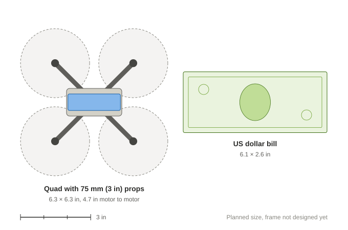

# Micro quadcopter with a custom Arduino flight controller

I'm building a sub-100 g brushed quadcopter. I'm designing the frame in SolidWorks and 3D printing it, writing the flight control code myself for an Arduino Nano, and building the handheld radio transmitter from an Arduino Uno.

Status, Nov 2026: I'm ordering parts and starting the CAD. No hardware has been built or tested yet. The target for a first hover is January 2027.

*Planned size, to scale. With props it spans about 6.3 in, about the width of a dollar bill.*

## Design
| Subsystem | Approach |
|---|---|
| Flight controller | Arduino Nano (ATmega328P) running my own firmware: a complementary filter on the IMU data, cascaded PID (an angle loop feeding a rate loop), motor mixing, arming and failsafes |
| Sensors | MPU-6050 6-axis gyro and accelerometer over I2C |
| Propulsion | 4× 8520 coreless brushed motors with 75 mm props, each driven by a logic-level MOSFET |
| Power | 1S 600 mAh LiPo, with an MT3608 boost converter to 5 V for the logic |
| Radio | nRF24L01+ 2.4 GHz link with a 250 ms failsafe |
| Transmitter | Arduino Uno and two analog joysticks in a 3D-printed case |
| Frame | PETG frame, about 120 mm motor to motor on the diagonal, with prop guards, designed in SolidWorks |

The target all-up weight is about 80 g, for a thrust-to-weight ratio of about 1.5-2:1. The sizing math (thrust-to-weight, battery sag, current, motor driver parts) is in [docs/design-calcs.md](docs/design-calcs.md). My current estimate is about 92 g, so weight is the main risk, and a thrust test on the real motors comes before the frame design.

## Repository layout
| Path | Contents |
|---|---|
| `PLAN.md` | Progress log, decisions and the reasons for them, problems I ran into |
| `TIMELINE.md` | Build schedule |
| `SAFETY.md` | Battery, prop and soldering safety, and the staged test procedure |
| `parts.md` | Bill of materials and weight budget |
| `docs/design-calcs.md` | Sizing calculations, updated as measurements replace estimates |
| `docs/design-review-2026-11-12.md` | Design review done before buying parts |
| `docs/data/` | Test data as CSV, starting with the motor thrust test |
| `firmware/` | Flight controller code (Arduino IDE), not added yet |
| `transmitter/` | Transmitter code, not added yet |
| `cad/` | SolidWorks parts and STL exports, not added yet |

## Safety
The quad will fly indoors only, with prop guards on. Testing goes in stages: on the bench, then with props off, then on a single-axis test rig, then tethered, then a free hover. It's under 250 g and flown for recreation, and I'll take the FAA's free TRUST safety test before it flies. Details are in [SAFETY.md](SAFETY.md).

## Progress
I track the work in [Issues](../../issues) and [Milestones](../../milestones), with one milestone per build phase.

## What I've learned so far
I log lessons as they come up in the Lessons table in [PLAN.md](PLAN.md). A few from planning:
- Thrust-to-weight sets the weight limit. With about 120 g of thrust and a 1.5:1 target, the whole quad has to weigh 80 g or less, so every part gets weighed.
- A bench test can mislead. One motor on a fresh battery sees about 3.9 V, but four motors in flight pull the battery down to about 3.0-3.3 V, so I record the voltage at the motor and scale the result.
- A MOSFET's exact part number matters. The IRF540 needs about 10 V on its gate; the logic-level IRLZ44N turns fully on from a 5 V Arduino pin.
- A regulator's current limit matters as much as its voltage. The Nano's 3.3 V pin can't supply the radio's transmit spikes, so the radio gets its own regulator.
- Some pins have a second job. D10 is the SPI select pin, and starting the radio drives it high, so the motor pins have to be set low first.
- Printed holes come out 0.1-0.3 mm smaller than drawn, so I print a test piece with a range of hole sizes before the real frame.

## License
[MIT](LICENSE)

## About
This is a personal project. I'm a mechanical engineering student at the University of Illinois Urbana-Champaign, and I'm building it to learn embedded control, electronics and CAD.
